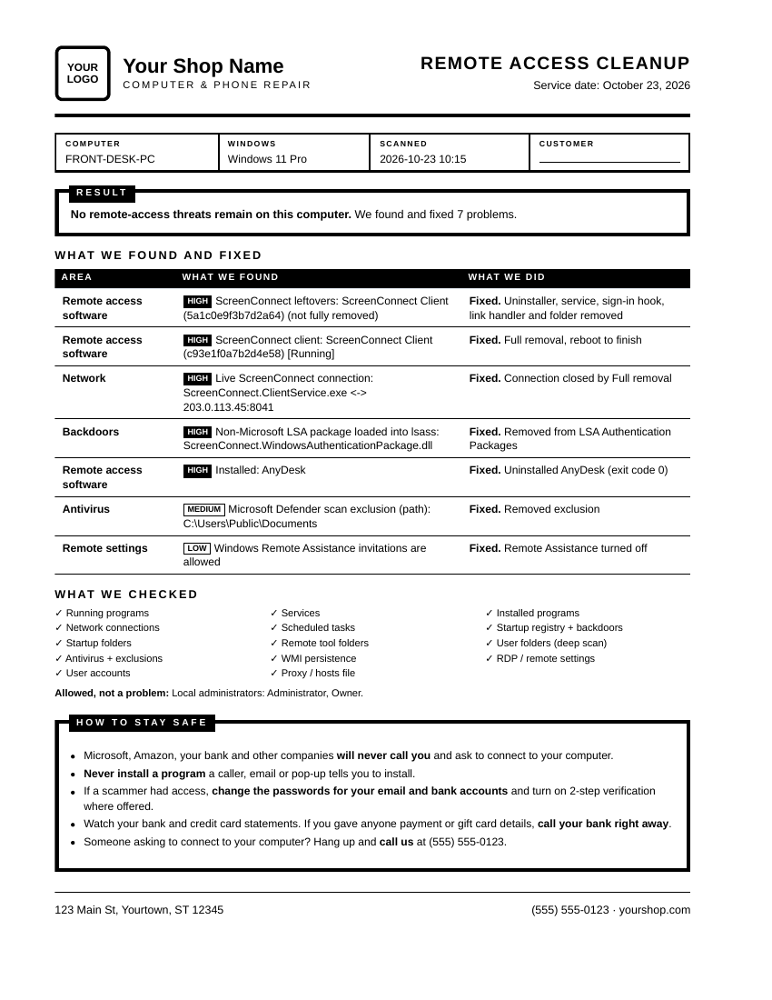

<h1 align="center">Remote Access Audit for Repair Shops</h1>

<p align="center">
  <b>Find and remove the remote-access tools tech-support scammers leave on Windows PCs.</b><br>
  Your shop's name and logo. Your own web address. One command on the customer's PC.
</p>

<p align="center">
  <code>irm audit.yourshop.com | iex</code>
</p>

<p align="center">
  
  <br><sub>The one-page customer report, printed in black and white with your branding.</sub>
</p>

---

## What it does

Scammers who "fix" a customer's computer leave a way back in. This audit finds those programs and removes them, then prints a clean report you can hand to the customer.

- **Finds remote-access software.** ScreenConnect, AnyDesk, TeamViewer, RustDesk, VNC, SimpleHelp and 70+ others, including hidden and portable copies.
- **Finds what they leave behind.** Sign-in screen hooks, LSA packages, startup entries, scheduled tasks, services, antivirus exclusions, WMI persistence and RDP settings.
- **Fixes it with one click.** Each finding has a **Fix** button. Files are quarantined, not deleted, and registry keys are backed up first.
- **Cleans up broken ScreenConnect installs.** It removes leftover copies whose own uninstaller fails.
- **Prints a one-page customer report.** Black and white, with your logo, address and phone number.
- **Keeps everything on the PC.** The audit sends nothing anywhere. The report is saved to the Desktop.
- **Works on Windows 7 SP1, 8.1, 10 and 11.**

## Try it first (no setup)

Want to see it before you set anything up? Run our hosted copy on any Windows PC. Open **Windows PowerShell** and paste:

```powershell
irm audit.nerdyneighbor.net | iex
```

It's the same audit your shop gets, with Nerdy Neighbor's name and logo on it. Click **Yes** on the Windows prompt, look through the findings, then close the window to see the report. Click **Print (1 page)** to preview the customer report.

> Our copy treats the remote tools *we* deploy (SuperOps, OpenSSH and our own RustDesk server) as allowed. To see every tool flagged, the way your own copy will by default, run this instead:
> ```powershell
> $env:NN_AUDIT_TRUST='none'; irm audit.nerdyneighbor.net | iex
> ```

You don't have to click any Fix buttons to try it. Scanning on its own changes nothing.

## What you need

| | |
|---|---|
| **Cloudflare account** | Free. Hosts your audit page. Sign up at [dash.cloudflare.com](https://dash.cloudflare.com/sign-up). |
| **A domain** *(optional)* | For `audit.yourshop.com`. Without one you get `yourshop-audit.pages.dev`. |
| **Node.js 18 or newer** | Runs the setup script. Get it at [nodejs.org](https://nodejs.org). |
| **Your logo** | PNG, JPG or SVG. Square works best, about 240 x 240. |

## Set it up (about 5 minutes)

**1. Download this repo**

```bash
git clone https://github.com/nerd-industries/audit-whitelabel.git
cd audit-whitelabel
```

No Git? Click **Code → Download ZIP** above, unzip it and open a terminal in that folder.

**2. Run the setup script**

```bash
node deploy.mjs
```

It asks for your shop name, tagline, address, phone, website, the address you want (like `audit.yourshop.com`) and your logo file. Then it:

- logs you in to Cloudflare in your browser (the first time only),
- creates your Cloudflare Pages site and uploads it,
- connects your custom domain and DNS record when your domain is on Cloudflare,
- checks that the site works.

**3. That's it.** Open `https://audit.yourshop.com` in a browser to see your page.

> If your domain's DNS isn't on Cloudflare, the script tells you the one CNAME record to add at your DNS provider.

## Use it on a customer's PC

1. Open **Windows PowerShell** and run:
   ```powershell
   irm audit.yourshop.com | iex
   ```
   On Windows 7, use: `[Net.ServicePointManager]::SecurityProtocol='Tls12'; irm audit.yourshop.com | iex`
2. Click **Yes** on the Windows prompt. The scan takes about a minute.
3. Review the findings. Click **Fix** on each one, or **Fix all HIGH**. Then click **Rescan** to confirm.
4. Close the window. The report opens in the browser.
5. Click **Print (1 page)** for the customer's copy.

Reboot afterwards if ScreenConnect was removed. Its last file unlocks at restart.

## Keeping it up to date

**You don't need to do anything.** Every run fetches the latest audit from [nerd-industries/Remote-Access-Audit](https://github.com/nerd-industries/Remote-Access-Audit) and adds your branding at the moment it's downloaded. New detections and fixes reach your techs automatically.

To change your name, logo or contact details, run `node deploy.mjs` again. Press Enter to keep any value.

To pick up a new version of this setup tool:

```bash
git pull
node deploy.mjs --update
```

## Options

Set these in **Cloudflare → Workers & Pages → your project → Settings → Variables and Secrets**, then run `node deploy.mjs --update`.

| Variable | What it does |
|---|---|
| `GITHUB_TOKEN` | Serves each new audit version the moment it's published, instead of up to 5 minutes later. Use a GitHub token with read access to public repos. |
| `UPSTREAM_URL` | Serve the audit script from somewhere else, such as your own fork. |

**Trusted tools.** By default every remote-access tool is reported as a finding, including RustDesk. If your shop uses an RMM tool that scammers don't use, you can add its name to `"trust"` in `brand.json` (for example `["NinjaOne"]`) so it shows as "Allowed". Never add a tool scammers also use, like RustDesk, AnyDesk or ScreenConnect. The audit can't tell your copy from theirs.

## How it works

```
Customer PC                    audit.yourshop.com (Cloudflare Pages)          GitHub
irm audit.yourshop.com | iex ─► Pages Function ─► fetches the latest ─────────► RemoteAccessAudit.ps1
                               adds your $RAA_Brand block
                               (name, logo, address, phone)
◄────────────────────────────── branded script runs on the PC
```

- `functions/index.js` serves the branded script to PowerShell and a branded instructions page to browsers.
- `brand.json` and `public/logo.*` hold your details. `deploy.mjs` writes both.
- The audit runs entirely on the customer's PC. Quarantine, backups and logs are kept in `C:\ProgramData\<YourShop>\RemoteAccessAudit`.

## FAQ

**Is it free?**
Yes. Cloudflare Pages' free plan is far more than a repair shop needs.

**Does it send customer data anywhere?**
No. It downloads the script, scans the PC and saves the report locally. Nothing is uploaded.

**Can I undo a fix?**
Yes. Quarantined files are in `C:\ProgramData\<YourShop>\RemoteAccessAudit\quarantine`, and registry backups (`.reg` files) are in `...\backup`.

**Something went wrong.**
Open an issue on [Remote-Access-Audit](https://github.com/nerd-industries/Remote-Access-Audit/issues) and attach the JSON report from the Desktop.

---

<p align="center">
  Built at <a href="https://nerdyneighbor.net">Nerdy Neighbor</a> in Prescott, AZ, from real scam cleanups. MIT licensed.
</p>
